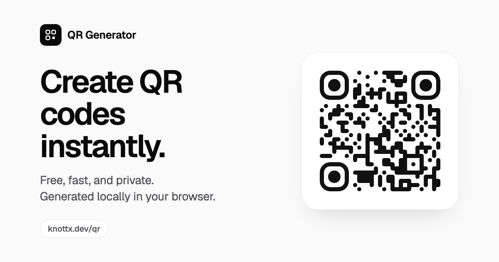

# QR Code Generator

A minimalist, private QR code generator that runs entirely in your browser.

**Live:** [https://knottx.dev/qr/](https://knottx.dev/qr/)



## Overview

Paste a link or type any text and get a crisp, scannable QR code instantly. Customize its colors and shape, then export a high-resolution PNG or SVG, or copy the image straight to your clipboard. There's no backend, no account, and no tracking.

## Features

- **Instant generation:** the preview updates as you type, with debounced rendering
- **URLs and plain text:** full UTF-8 support, so Thai, emoji and accented characters encode correctly
- **Customization**
  - Foreground and background colors (color picker or hex input)
  - Optional transparent background
  - Dot styles: square, rounded, dots
  - Corner frame (square, rounded, circle) and corner center (square, circle) styles
  - Error correction levels Low, Medium, Quartile and High, each labelled with how much damage it recovers from (default **Quartile**)
  - Export size: 512, 1024, 2048 or 4096 px
  - One-click reset to defaults
- **Export:** download PNG or SVG, or copy a PNG to the clipboard where the browser supports it
- **Scan-safety hints:** warns about low-contrast or inverted color combinations
- **Validation:** a live byte counter checks against QR capacity; exports are disabled when the content can't be encoded
- **Light and dark mode:** follows the system setting by default, with a manual override
- **Remembers your settings:** theme and customization are saved in `localStorage` (the QR content itself is never stored)
- **Accessible:** semantic HTML, labelled controls, native radio groups for keyboard navigation, visible focus rings, and support for `prefers-reduced-motion`
- **Responsive:** two columns with a sticky preview on desktop, a single column on mobile

## Tech stack

- [React](https://react.dev) and [TypeScript](https://www.typescriptlang.org) (strict mode)
- [Vite](https://vite.dev)
- [Tailwind CSS v4](https://tailwindcss.com)
- [qr-code-styling](https://github.com/kozakdenys/qr-code-styling)
- [lucide-react](https://lucide.dev) icons
- [Geist](https://vercel.com/font) typeface (self-hosted via Fontsource)

## Local development

Requires Node.js 20.19+ (Node 24 recommended).

```bash
npm install
npm run dev
```

Then open the URL Vite prints, for example `http://localhost:5173/qr/`.

## Build

```bash
npm run typecheck   # TypeScript only
npm run build       # type-check + production build into dist/
npm run preview     # serve the production build locally at /qr/
```

## Deployment (GitHub Pages)

This app is deployed as a GitHub Pages **project site**, served at `https://knottx.dev/qr/` through the custom domain configured on the main user site. For that reason:

- `vite.config.ts` sets `base: '/qr/'`, and all asset URLs are generated relative to it.
- This repository has **no `CNAME` file**. The custom domain belongs to the user site repository.

Deployment is automated by [`.github/workflows/deploy.yml`](.github/workflows/deploy.yml). Every push to `main` type-checks the app, builds it, and publishes `dist/` using the official GitHub Pages actions. You can also start it manually from the **Actions** tab.

### One-time repository setup

1. Push this repository to GitHub as `qr` (the repository name must match the `/qr/` base path).
2. Go to **Settings → Pages → Build and deployment** and set **Source** to **GitHub Actions**.
3. Make sure the user site repository (`<username>.github.io`) has its custom domain set to `knottx.dev`. Project sites then become available at `https://knottx.dev/<repo>/` automatically.

## Privacy

QR codes are generated **locally in your browser**. What you type is never sent to a server, logged, or shared with any analytics service. The app has no backend, and the only data it stores is your theme and style preferences, in your browser's `localStorage`.

## License

[MIT](LICENSE)
